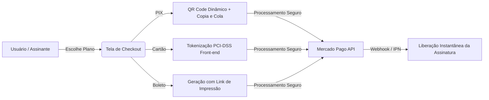

# 🦷 Odontfy — Plataforma SaaS para Gestão & Agendamento Odontológico

<p align="center">
  
  
  
  
  
</p>

<p align="center">
  <strong>Odontfy</strong> é uma solução completa em formato <strong>SaaS (Software as a Service)</strong> desenhada para modernizar o atendimento, a gestão clínica, o fluxo financeiro e os agendamentos online de consultórios e clínicas odontológicas.
</p>

<p align="center">
  <a href="#-principais-funcionalidades">Funcionalidades</a> •
  <a href="#-tecnologias-utilizadas">Tecnologias</a> •
  <a href="#-arquitetura-do-projeto">Arquitetura</a> •
  <a href="#-como-executar-localmente">Instalação</a> •
  <a href="#-fluxos-do-sistema">Fluxos</a> •
  <a href="#-integração-mercado-pago">Mercado Pago</a> •
  <a href="#-licença">Licença</a>
</p>

---

## 🌟 Destaques do Projeto

- 📅 **Agendamento Inteligente & Público**: Página exclusiva e personalizável para cada consultório (`/sua-clinica`), com bloqueio dinâmico de horários ocupados e seleção de profissional.
- 👨‍⚕️ **Multiprofissionais por Clínica**: Gestão de múltiplos dentistas com foto, CRO, biografia, especialidades e grade de horários individualizada.
- 🔔 **Notificações em Tempo Real**: Alertas sonoros (Web Audio API) e toasts animados instantâneos na dashboard a cada novo agendamento, sem necessidade de recarregar a tela.
- 💳 **Checkout Transparente com Mercado Pago**: Suporte completo a **PIX com QR Code dinâmico**, **Cartão de Crédito tokenizado** e **Boleto Bancário** com ativação automática via Webhook.
- 📊 **Módulo Financeiro & Relatórios**: Controle de fluxo de caixa (entradas/saídas), categorização inteligente, gráficos analíticos interativos via Chart.js e métricas de desempenho.
- 🛡️ **Painel Administrativo SuperAdmin**: Controle geral da plataforma com gestão de planos, assinaturas, clínicas cadastradas e métricas globais.

---

## 🚀 Principais Funcionalidades

### 🏢 Para Clínicas & Dentistas
- **Dashboard Operacional**: KPIs em tempo real (consultas hoje, total agendado, taxa de conversão, faturamento).
- **Gestão de Equipe**: Cadastro de múltiplos dentistas com controle de especialidades e turnos.
- **Catálogo de Serviços**: Configuração de tratamentos com duração personalizada e valores.
- **Grade de Atendimento Flexível**: Definição de horários de funcionamento, intervalos e bloqueios de agenda.
- **Controle de Pacientes**: Prontuário básico com histórico de consultas e dados de contato.
- **Fluxo de Caixa**: Registro categorizado de receitas/despesas com filtros por período e análise de saldo.
- **Gestão de Planos & Assinaturas**: Sistema de trial (7 dias grátis) e upgrade facilitado para planos pagos.

### 🧑‍⚕️ Para Pacientes (Portal Público)
- **Link Exclusivo da Clínica**: Interface responsiva, limpa e de fácil navegação (mobile-first).
- **Seleção Dinâmica**: Escolha do dentista de preferência e do procedimento odontológico.
- **Reserva em Tempo Real**: Calendário inteligente que exibe apenas horários verdadeiramente disponíveis.
- **Confirmação Instantânea**: Resumo imediato dos dados do agendamento com orientação ao paciente.

### ⚡ Para Administradores Globais (SuperAdmin)
- **Painel Administrativo Dedicado**: Visão macro da operação da plataforma.
- **Gerenciamento de Assinantes**: Ativação, suspensão e cancelamento de planos.
- **Relatórios Gerenciais**: Análise de crescimento de clínicas parceiras e faturamento de assinaturas.

---

## 🛠️ Tecnologias Utilizadas

O sistema foi concebido com uma arquitetura leve, de alta performance e baixíssimo custo de hospedagem:

| Camada | Tecnologia |
| :--- | :--- |
| **Backend** | PHP 7.4 / PHP 8.x (Arquitetura RESTful leve e modular) |
| **Frontend** | HTML5 semântico, JavaScript moderno (ES6+) |
| **Estilização** | Tailwind CSS (Interface limpa, moderna e 100% responsiva) |
| **Componentes Visuais** | Font Awesome 6, Chart.js (gráficos analíticos) |
| **Áudio / Notificações** | Web Audio API nativa + Polling assíncrono otimizado |
| **Gateway de Pagamento** | Mercado Pago SDK / REST API (Checkout Transparente + Webhooks) |
| **Camada de Dados** | JSON Data Engine / Estrutura relacional modular (Pronta para migração SQL) |
| **Servidor Web** | Apache com `mod_rewrite` habilitado via `.htaccess` |

---

## 📁 Arquitetura do Projeto

```text
odontfy/
├── 📁 api/                          # Endpoints REST e Webhooks assíncronos
│   ├── check_new_bookings.php       # Verificação em tempo real de novos agendamentos
│   ├── get_dentista_available_times # Cálculo dinâmico de slots livres por profissional
│   ├── get_occupied_times.php       # Consulta de horários bloqueados
│   ├── mercadopago_create_payment.php # Processamento PIX / Cartão
│   ├── mercadopago_webhook.php      # Listener de notificações do gateway
│   └── update_status_agendamento.php # Atualização de status da consulta
├── 📁 config/                       # Regras de negócio centrais e banco de dados
│   └── database.php                 # Camada de persistência e repositórios
├── 📁 data/                         # Armazenamento de dados do sistema (JSON)
├── 📁 uploads/                      # Uploads de fotos de dentistas e avatares
├── 📄 index.php                     # Landing page promocional do SaaS
├── 📄 agendar.php                   # Portal público de agendamento do paciente
├── 📄 dashboard.php                 # Painel principal do dentista/clínica
├── 📄 dentistas_consultorio.php     # Gestão da equipe de dentistas
├── 📄 financeiro.php                # Controle financeiro e lançamentos
├── 📄 relatorios_financeiros.php    # Relatórios gráficos e métricas
├── 📄 pagamento.php                 # Checkout com PIX, Cartão e Boleto
├── 📄 admin_dashboard.php           # Painel SuperAdmin da plataforma
└── 📄 .htaccess                     # Regras de URL amigável e roteamento
```

---

## 💳 Integração Mercado Pago

O Odontfy traz implementada uma solução de checkout transparente de ponta a ponta:



- **PIX Instantâneo**: Verificação periódica automática a cada 5 segundos com feedback em modal.
- **Cartão de Crédito**: Conformidade total com PCI-DSS graças à tokenização direta no client-side.
- **Webhooks Confiáveis**: Liberação imediata de recursos assim que o pagamento é liquidado.

---

## 🚀 Como Executar Localmente

### 📋 Pré-requisitos
- **PHP 7.4 ou superior**
- **Servidor Apache** (ex: [XAMPP](https://www.apachefriends.org/), Laragon ou Docker)
- Extensões PHP recomendadas: `cURL`, `OpenSSL`, `JSON`, `mbstring`

### 💻 Passo a Passo

1. **Clone o repositório:**
   ```bash
   git clone https://github.com/SEU-USUARIO/odontfy.git
   ```

2. **Mova para o diretório raiz do seu servidor:**
   - No **XAMPP**: copie para a pasta `C:/xampp/htdocs/odontfy`
   - No **Laragon**: copie para `laragon/www/odontfy`

3. **Verifique as permissões de escrita:**
   Certifique-se de que as pastas `data/` e `uploads/` possuem permissão total de leitura e escrita.

4. **Inicie o servidor Apache.**

5. **Acesse no seu navegador:**
   ```text
   http://localhost/odontfy
   ```

---

## 🎯 Credenciais & Testes Rápidos

- **Cadastro Rápido**: Clique em "Experimente Grátis" na página inicial e conclua o cadastro com 7 dias de trial liberados.
- **Painel Administrativo**: Acesse `/admin_login.php` para recursos de SuperAdmin.
- **Testes de Pagamento**: O sistema possui rotas e mocks prontos para testes de credenciais Sandbox do Mercado Pago.

---

## 🛡️ Segurança & Boas Práticas

- 🔒 **Sanitização de Entradas**: Filtragem de inputs contra XSS e injeção maliciosa.
- 🔑 **Sessões Blindadas**: Controle de autenticação e proteção de rotas restritas.
- 💳 **Segurança Financeira**: Nenhum dado crítico de cartão trafega de forma desprotegida pelo servidor local.

---

## 🤝 Contribuições

Contribuições são super bem-vindas! Se você deseja colaborar com novas features ou melhorias:

1. Faça um **Fork** do projeto
2. Crie uma nova branch: `git checkout -b feature/minha-feature`
3. Commit suas alterações: `git commit -m 'feat: adiciona nova funcionalidade'`
4. Faça o push para a branch: `git push origin feature/minha-feature`
5. Abra um **Pull Request**

---

<p align="center">
  Desenvolvido com foco em alta conversão e excelência na gestão odontológica. 🦷✨
</p>
